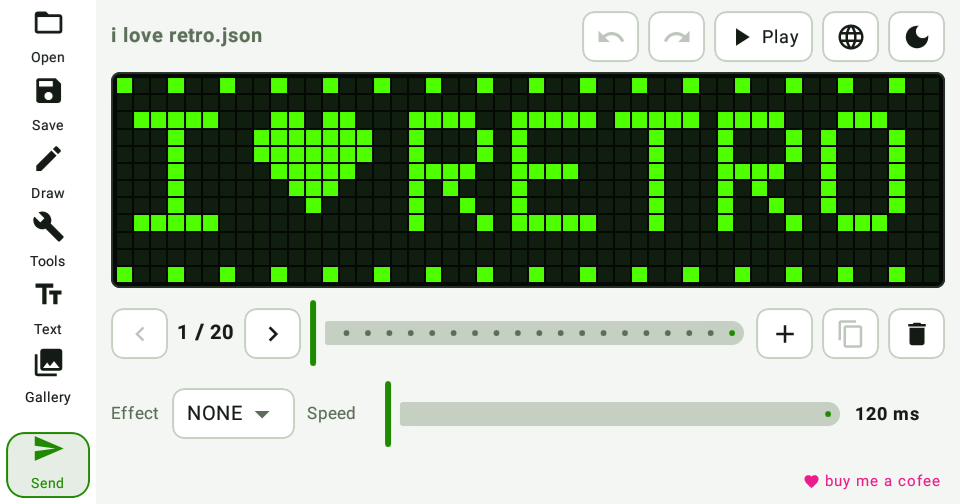

# SpotLED Editor for Android

<p align="center"><a href="https://buymeacoffee.com/adamstrad">💗 buy me a cofee</a></p>

<p align="center"><a href="https://ordigital.github.io/spotled-android/"><b>Open the online editor</b></a> (Chrome, Chromium or Edge)</p>

A native Android editor for animations on SpotLED 48×12 LED boards, controlled over Bluetooth LE. An experimental browser version is also available in `web/`; see [Web version (experimental)](#web-version-experimental).



> **Disclaimer:** This is an independent, unofficial hobby project. The author is **not** affiliated with, endorsed by, or connected to the manufacturer of the SpotLED device. Product names are used only to describe compatibility. The software is provided as is, use at your own risk.

## Features

- Draw animations pixel by pixel with up to **20 frames**, with undo/redo and a preview of the previous frame.
- **Text tab** with built-in fonts and custom `.slf` fonts (for example, Amstrad CPC).
- **Gallery** of ready-made animations.
- **PNG import** and text placement with drag-and-drop positioning.
- Save and load projects as **JSON** files.
- **Send animations to the board** over BLE.
- **12 UI languages**: English, Polish, German, French, Spanish, Italian, Czech, Hungarian, Ukrainian, Russian, Chinese, Japanese.
- Dark and light themes.
- Landscape, full-screen interface.

## Requirements

- Android 5.0 (API 21) or newer (tested on Android 6 and 12). On Android 6–11 the app asks for the location permission, which the system requires for BLE scanning; on Android 12+ it asks for the Bluetooth permissions instead.
- A phone with Bluetooth LE.
- A SpotLED board.

> **Note:** Sending animations from the board view has been tested on hardware. The Text tab and custom fonts have **not yet been thoroughly tested** on the board.

## Web version (experimental)

The browser version lives in `web/`. It is plain HTML/JavaScript with no build step, and it talks to the board over Web Bluetooth.

- **Supported browsers:** Chrome, Chromium or Edge on desktop Linux and Windows, and on Android. macOS is not guaranteed. Firefox and Safari do not support Web Bluetooth.
- **Brave:** enable `brave://flags/#brave-web-bluetooth-api`.

To try it locally, serve the folder (Web Bluetooth requires HTTPS or `localhost`):

```bash
python3 -m http.server 8765 --directory web
```

Then open http://localhost:8765.

Hosting on GitHub Pages is planned at https://ordigital.github.io/spotled-android/.

The web version has the same features as the app: canvas editor, frames, tools, text tab, gallery, open/save JSON, 12 languages, and light/dark theme.

To run the protocol self-test:

```bash
node web/selftest.mjs
```

### Linux (BlueZ) troubleshooting

The board also advertises a HID (gamepad) service. BlueZ (tested with 5.87) tries to set it up, fails, and keeps dropping the connection. A "device requests access" pairing popup also keeps appearing. The page then reports `GATT Server is disconnected` or a service-not-found error.

If a pairing popup appears, dismissing it is fine.

Workaround: run `bluetoothd` without the input-related plugins while you use the board:

```bash
sudo mkdir -p /etc/systemd/system/bluetooth.service.d
printf '[Service]\nExecStart=\nExecStart=/usr/lib/bluetooth/bluetoothd --noplugin=input,hog,deviceinfo\n' | sudo tee /etc/systemd/system/bluetooth.service.d/noinput.conf
sudo systemctl daemon-reload && sudo systemctl restart bluetooth
```

Adjust the `ExecStart` path if `bluetoothd` lives elsewhere; `systemctl cat bluetooth` shows it.

> **Warning:** this disables Bluetooth mice and keyboards (HID) system-wide. Revert it afterwards:
>
> ```bash
> sudo rm /etc/systemd/system/bluetooth.service.d/noinput.conf
> sudo systemctl daemon-reload && sudo systemctl restart bluetooth
> ```

BlueZ has no per-device switch for this. Android and the native app are not affected.

## Build

Requirements: JDK 17 and the Android SDK.

1. Create `local.properties` in the project root:

   ```properties
   sdk.dir=/path/to/android-sdk
   ```

2. Create a debug keystore in the project root (the system `~/.android/debug.keystore` does not contain the `AndroidDebugKey` alias the project expects):

   ```bash
   keytool -genkeypair -keystore spotled-debug.keystore -storepass android -keypass android \
     -alias spotled -keyalg RSA -keysize 2048 -validity 10000 -dname "CN=SpotLED Debug"
   ```

3. Build the debug APK:

   ```bash
   ./gradlew :app:assembleDebug
   ```

   The APK is written to `app/build/outputs/apk/debug/app-debug.apk`.

4. Run the unit tests:

   ```bash
   ./gradlew :app:testDebugUnitTest
   ```

`local.properties` and the keystore are local files and are ignored by Git.

## Repository layout

| Path | Contents |
|---|---|
| `app/` | Android application (Kotlin, Jetpack Compose). Source in `app/src/main/java/app/spotled/gui/`, fonts and translations in `app/src/main/assets/`, tests in `app/src/test/`. |
| `examples/` | Project JSON files. Projects with exactly 20 frames appear in the gallery. |
| `tools/` | Python 3 (standard library only) generators for example animations. |

## License

Not decided yet.
